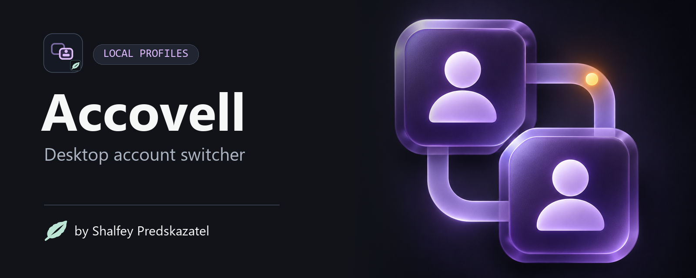

# Accovell

**A local Windows dashboard for Codex profiles.** Free to download.  
Product identity: **Accovell** · by **Shalfey Predskazatel**

[Download the latest release](https://github.com/Shalfey-Predskazatel/Accovell/releases/latest) · [Source code](https://github.com/Shalfey-Predskazatel/Accovell) · [Release notes](RELEASE-NOTES.md) · [Report an issue](https://github.com/Shalfey-Predskazatel/Accovell/issues)

Accovell brings Codex profile selection, usage information, shared settings, and a local request route together in one Windows app. Sign-in and quota information come from the official Codex CLI installed on your PC.

## What it does

- Add and manage multiple local Codex profiles.
- View the usage and reset information returned by Codex CLI.
- Choose a profile manually, or enable automatic selection for future requests after Codex explicitly reports an exhausted quota. The stopped request is not replayed, and existing response chains stay with the profile that started them.
- Change shared model, reasoning, approval, sandbox, and instruction settings.
- Use the system tray, refresh schedule, startup option, sounds, and app themes.
- Create user-selected backups. An export without a password contains OAuth credentials in plain text; protect it and never upload it to this repository.

## Downloads

- [Windows x64 installer](https://github.com/Shalfey-Predskazatel/Accovell/releases/latest/download/Accovell-0.1.0-Setup-x64.exe)
- [Windows x64 portable build](https://github.com/Shalfey-Predskazatel/Accovell/releases/latest/download/Accovell-0.1.0-Portable.zip)

The installer uses Microsoft's WebView2 bootstrapper if the runtime is missing and needs an internet connection for that step. The portable folder contains the app and WebView2 loader; Windows WebView2 Runtime must already be installed. See the release notes for the exact build contents.

## Requirements

- Windows 10 or 11, x64.
- The official Codex CLI installed and signed in for profile and usage operations.
- A compatible WebView2 Runtime.

Accovell stores its profiles on the local PC and uses Windows DPAPI for credential protection. Do not publish profile exports, app data, or personal Codex configuration.

## Source and build

The repository includes the application source and installer source. See [BUILDING.md](BUILDING.md). Offline dependency caches from the private handoff bundle are not included.

The source is public for inspection. No reuse license is specified for this project. Third-party components keep their own license terms.

## Product name

Accovell is the product brand. The supplied r85 executable and installer still show **Codex Accounts** in some Windows UI labels.

## Independent project

Accovell is an independent community project and is not affiliated with or endorsed by OpenAI. Codex and OpenAI are referenced only to describe compatibility.

---

## Русский

**Accovell** — локальная панель управления профилями Codex для Windows. Программа бесплатна для скачивания. Автор: **Shalfey Predskazatel**.

[Скачать последнюю версию](https://github.com/Shalfey-Predskazatel/Accovell/releases/latest) · [Исходный код](https://github.com/Shalfey-Predskazatel/Accovell) · [Примечания к выпуску](RELEASE-NOTES.md) · [Сообщить о проблеме](https://github.com/Shalfey-Predskazatel/Accovell/issues)

Accovell объединяет выбор профиля Codex, сведения об использовании, общие настройки и локальный маршрут запросов. Вход и данные об использовании берутся из официального Codex CLI, установленного на компьютере.

## Возможности

- Добавление и управление несколькими локальными профилями Codex.
- Просмотр использования и времени сброса, полученных от Codex CLI.
- Ручной выбор профиля или автоматический выбор для будущих запросов после явного ответа Codex об исчерпании квоты. Остановленный запрос не отправляется повторно, а уже начатая цепочка ответов остаётся у исходного профиля.
- Общие настройки модели, рассуждений, подтверждений, песочницы и инструкций.
- Системный трей, интервал обновления, автозапуск, звуки и темы приложения.
- Резервное копирование по выбору пользователя. Экспорт без пароля содержит OAuth-данные открытым текстом: защищайте его и не загружайте в этот репозиторий.

## Скачать

- [Установщик Windows x64](https://github.com/Shalfey-Predskazatel/Accovell/releases/latest/download/Accovell-0.1.0-Setup-x64.exe)
- [Portable-версия Windows x64](https://github.com/Shalfey-Predskazatel/Accovell/releases/latest/download/Accovell-0.1.0-Portable.zip)

Если WebView2 Runtime отсутствует, установщик запускает bootstrapper Microsoft и для этого шага требуется интернет. Portable-папка содержит программу и загрузчик WebView2, но сам WebView2 Runtime должен быть уже установлен в Windows.

## Требования

- Windows 10 или 11, x64.
- Установленный и авторизованный официальный Codex CLI для работы с профилями и использованием.
- Совместимый WebView2 Runtime.

Профили хранятся на компьютере пользователя, а приложение защищает учётные данные средствами Windows DPAPI. Не публикуйте резервные копии профилей, данные приложения и личную конфигурацию Codex.

В репозитории есть исходный код приложения и установщика. См. [BUILDING.md](BUILDING.md). Кэши зависимостей из закрытого комплекта передачи не публикуются.

Исходники доступны для ознакомления. Лицензия на повторное использование этого проекта не указана. Для сторонних компонентов действуют их собственные лицензии.

Accovell — независимый проект, не связанный с OpenAI и не одобренный OpenAI. Названия Codex и OpenAI используются только для обозначения совместимости.
