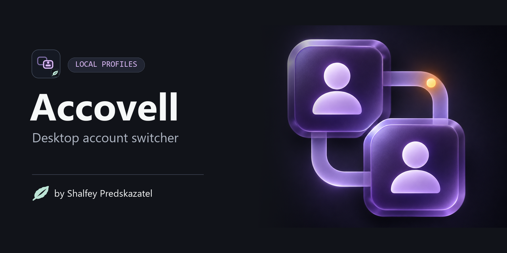

# Accovell

[English](README.md) · **Русский**

**Локальная панель управления профилями Codex для Windows.** Программа бесплатна для скачивания.  
Бренд продукта: **Accovell** · автор **Shalfey Predskazatel**

[Скачать последнюю версию](https://github.com/Shalfey-Predskazatel/Accovell/releases/latest) · [Исходный код](https://github.com/Shalfey-Predskazatel/Accovell) · [Примечания к выпуску](RELEASE-NOTES.md) · [Сообщить о проблеме](https://github.com/Shalfey-Predskazatel/Accovell/issues)

Accovell объединяет выбор профиля Codex, сведения об использовании, общие настройки и локальный маршрут запросов. Вход и данные об использовании берутся из официального Codex CLI, установленного на компьютере.

## Возможности

- Добавление и управление несколькими локальными профилями Codex.
- Просмотр использования и времени сброса, полученных от Codex CLI.
- Ручной выбор профиля или автоматический выбор для будущих запросов после явного ответа Codex об исчерпании квоты. Остановленный запрос не отправляется повторно, а уже начатая цепочка ответов остаётся у исходного профиля.
- Общие настройки модели, рассуждений, подтверждений, песочницы и инструкций.
- Системный трей, интервал обновления, автозапуск, звуки и темы приложения.
- Резервное копирование по выбору пользователя. Экспорт без пароля содержит OAuth-данные открытым текстом: защищайте его и не загружайте в этот репозиторий.

## Скачать

- [Установщик Windows x64](https://github.com/Shalfey-Predskazatel/Accovell/releases/latest/download/Accovell-0.1.0-Setup-x64.exe)
- [Portable-версия Windows x64](https://github.com/Shalfey-Predskazatel/Accovell/releases/latest/download/Accovell-0.1.0-Portable.zip)

Если WebView2 Runtime отсутствует, установщик запускает установочный модуль Microsoft и для этого шага требуется интернет. Portable-папка содержит программу и загрузчик WebView2, но сам WebView2 Runtime должен быть уже установлен в Windows.

## Требования

- Windows 10 или 11, x64.
- Установленный и авторизованный официальный Codex CLI для работы с профилями и данными об использовании.
- Совместимый WebView2 Runtime.

Профили хранятся на компьютере пользователя, а приложение защищает учётные данные средствами Windows DPAPI. Не публикуйте резервные копии профилей, данные приложения и личную конфигурацию Codex.

## Исходный код и сборка

В репозитории есть исходный код приложения и установщика. См. [BUILDING.md](BUILDING.md). Кэши зависимостей из закрытого комплекта передачи не публикуются.

Исходники доступны для ознакомления. Лицензия на повторное использование этого проекта не указана. Для сторонних компонентов действуют их собственные лицензии.

## Название продукта

Accovell — название продукта. В некоторых элементах интерфейса Windows программы и установщика из сборки r85 пока отображается **Codex Accounts**.

## Независимый проект

Accovell — независимый проект сообщества, не связанный с OpenAI и не одобренный OpenAI. Названия Codex и OpenAI используются только для обозначения совместимости.
